

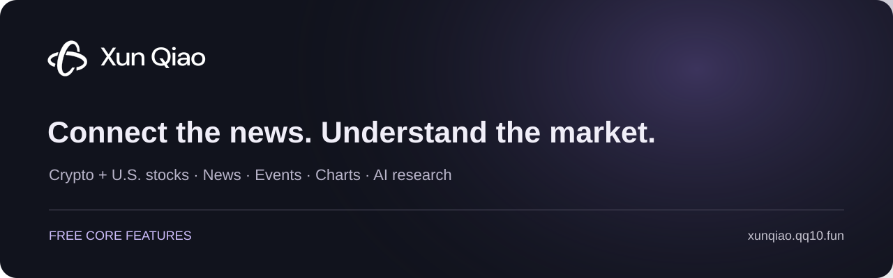

# Xun Qiao

### Follow the news. See the market.

**A free research workspace for crypto and U.S. stocks — connecting news, events, prices and AI analysis.**

**[Open the website](https://xunqiao.qq10.fun/) · [User guide](GUIDE.md) · [API guide](API-GUIDE.md) · [Feedback](https://github.com/xunqiao111/xunqiao-market-intelligence/issues)**

**1,000+ source coverage · Free core research · English / Chinese · Dark / light themes**

---

## What is Xun Qiao?

Market research rarely happens on one screen. A headline arrives in a news feed, a related asset moves on a chart, a funding-rate change appears somewhere else, and your original reasoning disappears into a note.

**Xun Qiao brings those pieces into one research workflow.** Read incoming news, open the affected assets, compare the price context, inspect the evidence, and keep track of what would support or invalidate a view.

You can explore the complete homepage without signing in. A **free account** unlocks the workbench, news reader, markets and published AI research. Optional **Gold membership** adds AI conversations and developer API access. No desktop installation or personal model-provider key is required.

<a href="assets/home.png">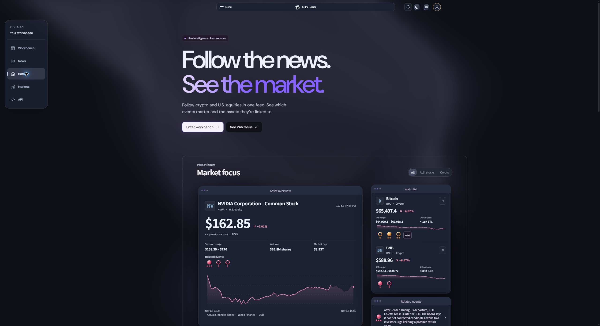</a>

**All screenshots below use the English interface and show the live website. Click any image to inspect its original resolution.** The captures are historical examples, not current prices or investment recommendations.

## Explore the product

| Start here | Continue here |
| --- | --- |
| [Homepage and market focus](#homepage-and-market-focus) | [Your research workbench](#your-research-workbench) |
| [The live news reader](#the-live-news-reader) | [AI Picks and event collections](#ai-picks-and-event-collections) |
| [Asset links and visual signals](#asset-links-and-visual-signals) | [Structured AI reports](#structured-ai-reports) |
| [Plans, comparisons and reviews](#plans-comparisons-and-reviews) | [Markets, charts and evidence](#markets-charts-and-evidence) |
| [GPT conversations](#gpt-conversations) | [Developer API](#developer-api) |
| [Accounts and membership](#accounts-and-membership) | [Personalization and notifications](#personalization-and-notifications) |

## One connected workflow

### Discover → Connect → Investigate → Record → Review

1. **Discover:** scan the market focus or read incoming headlines.
2. **Connect:** inspect the assets and sectors associated with an event.
3. **Investigate:** compare related reporting, price action and available research observations.
4. **Record:** save an event, write a note, or turn report conditions into a research plan.
5. **Review:** inspect later report changes and the five-hour observation window.

The same workflow serves a reader checking the morning news and a researcher following several assets throughout the day. It does not execute trades.

## Homepage and market focus

### A useful first screen, even without an account

The homepage is public. Visitors can read the prepared market overview, recent headlines, related-event previews and upcoming supply or activity dates without signing in. You do not need a membership just to see whether the service is useful.

### The past 24 hours, organized around assets

The market-focus section brings the most relevant assets into a small set of overview cards. Switch between **All, U.S. stocks and Crypto**, then open an asset for more context.

Each overview can show:

- The instrument's name, ticker, market category and displayed data time.
- The latest available price and change against the displayed comparison basis.
- A 24-hour or trading-session range, according to the instrument.
- Trading volume and market capitalization when available.
- A price-history line built from available market observations.
- Related event spheres, rings and star ratings, with an overflow control for additional events.

The nearby asset cards let you compare other important instruments without leaving the section. A symbol can refer to different instruments in different markets; the full name and category matter.

<a href="assets/focus.png">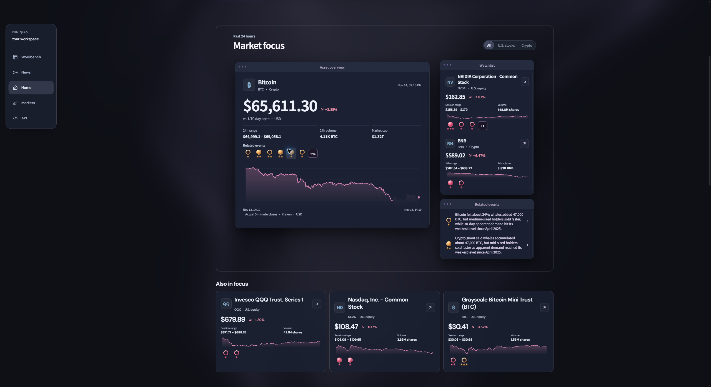</a>

### Headlines, dates and ways to continue

The homepage also provides a recent-news preview, an entry to the full reader, supply and activity dates, and an API example. Market-tool cards offer a quick route to deeper research rather than requiring you to start from a blank workspace.

The membership section explains the distinction between free research and optional premium services. You can continue into the workbench, explore the next calendar item, or return to a headline that caught your attention.

<a href="assets/home-tools.png">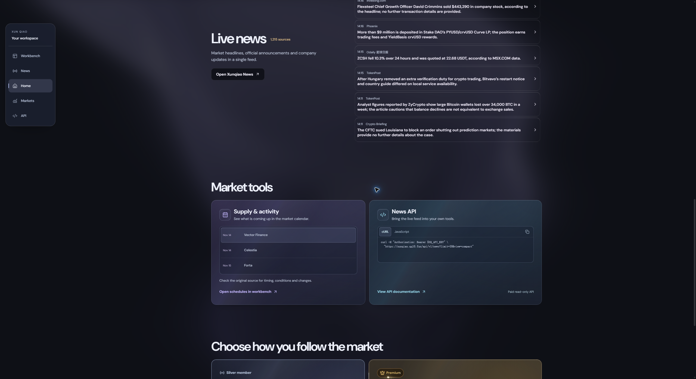</a>

## Your research workbench

### Choose several assets; focus on one at a time

The workbench starts with **Bitcoin and NVIDIA**. Add or remove instruments, then select the asset you want to investigate. Your current focus connects the chart, related events, research report, fundamentals and evidence panels.

The asset selector supports search and market categories, including crypto, stocks and stock tokens. It shows instrument identities and related-report counts so you can distinguish a company, an ETF and a tokenized instrument with similar lettering.

<a href="assets/asset-picker.png">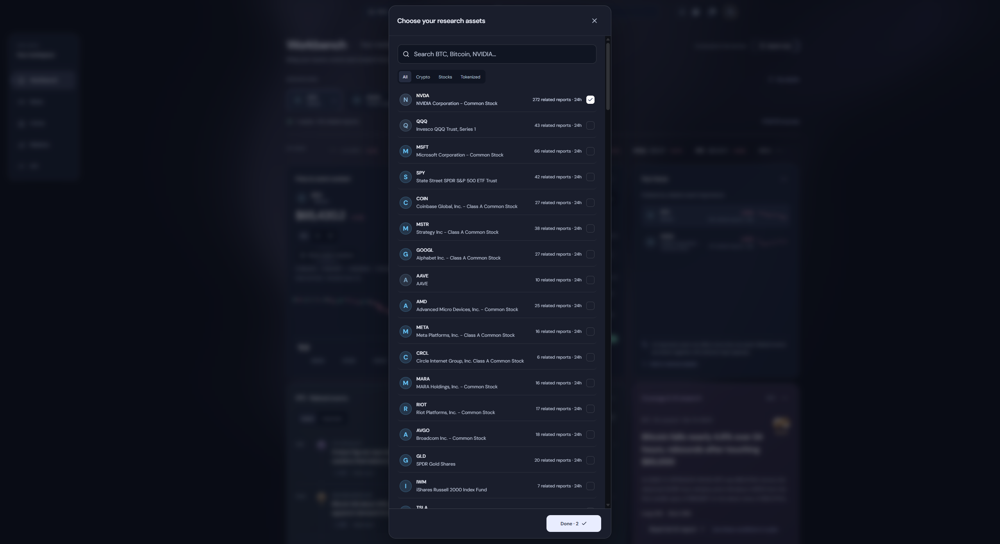</a>

### Price action and reporting, side by side

The main chart supports **5-minute, hourly and daily intervals**, with available open, high, low and close values. A refresh control and terminal timing information help you understand the view you are examining.

Event markers are **off by default**. Turn them on when you want to inspect news against a price timeline, then open a marker for its context. A reporting timestamp locates an item on the chart; it does not establish that the news caused a price move.

The adjacent focus list keeps other selected assets within reach. Switch the active instrument to investigate its own context instead of mixing every selected asset's events into one undifferentiated feed.

<a href="assets/workbench.png">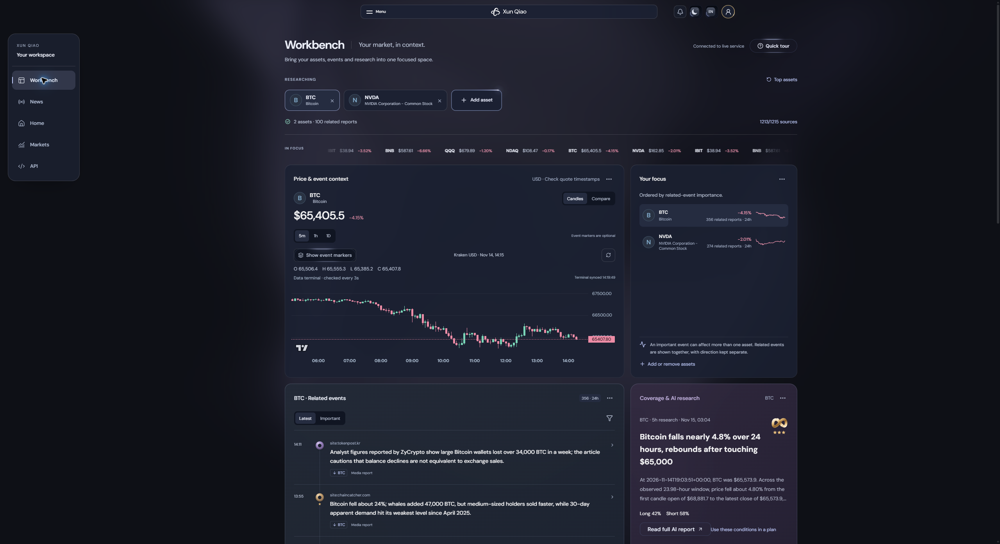</a>

### Related events and asset fundamentals

The related-event panel provides time, source, direction and importance context for the active instrument. Change between recent and important coverage, open filters, or continue into the full event ledger.

Fundamentals include the available price range, trading volume, market cap and association count. The range ruler provides a spatial way to compare a current quote with the displayed range. Source coverage varies; unavailable values remain unavailable rather than being silently treated as zero.

Association counts include lower-rated events as well as important ones. An event set can represent several distinct constituent reports, so a card count and a related-record count answer different questions.

<a href="assets/workbench-fundamentals.png">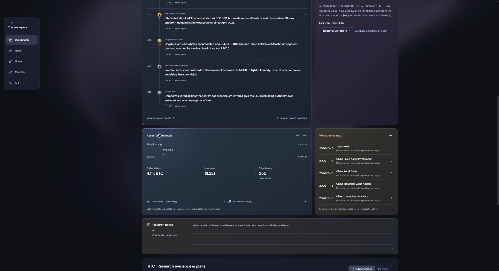</a>

### Research evidence beyond headlines

The research desk groups available observations by category. Depending on the asset and source coverage, these can include **derivatives, on-chain data, stablecoins, DeFi, the Bitcoin network, asset profiles, yields and unlocks**.

For example, a Bitcoin research view can show funding rates, open interest, hourly and daily open-interest changes, turnover and reference prices. Each observation retains a source label, observation time and unit. Expand the observation list or inspect original evidence when you need more detail.

These definitions are important: a funding rate without a stated period should not be annualized by assumption; turnover is not executable order-book depth; protocol revenue is not automatically tokenholder income. Historical third-party reporting is different from a current on-chain measurement.

<a href="assets/workbench-observations.png">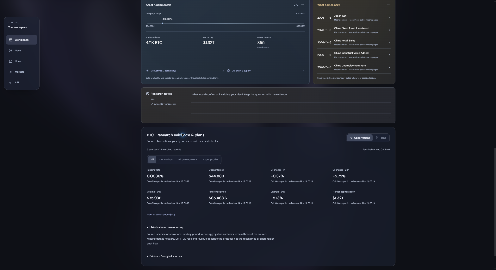</a>

### Notes, upcoming dates and the guided tour

Use research notes to keep the questions and evidence behind your view. The upcoming-agenda panel highlights matched supply, activity and company dates alongside broader macro context. Open an agenda item to inspect its details and source rather than interpreting every date as an asset-specific announcement.

The **Quick tour** introduces the workspace. Menus expose additional reading, source, panel and research controls, while the persistent navigation keeps the main sections available.

## The live news reader

### Four views for four reading tasks

| View | What it is for |
| --- | --- |
| **All news** | Scan the incoming stream, search a headline or follow a particular source. |
| **Official** | Read collected first-party announcements and company updates. |
| **AI Picks** | Prioritize selected events and follow their grouped developments. |
| **AI Reports** | Read structured, asset-specific research and its subsequent changes. |

Coverage includes **1,000+ source entries** across the site's directory. The count changes as the directory changes; it does not imply every source publishes continuously or has identical availability.

### Search, filter and save

Search by message text, ticker or source. Open filters to narrow the stream, choose which sources to receive, and save stories for later. Cards retain reporting time and attribution, with a path into context and original material.

New items enter automatically. When you are reading older material, the reader preserves your position rather than requiring a manual “show new items” step. The design aims to keep incoming information from interrupting the line you are reading.

Loading, connection and empty states have different meanings. A feed that is still preparing should be read as loading, not as proof that there are no events.

<a href="assets/news-all.png">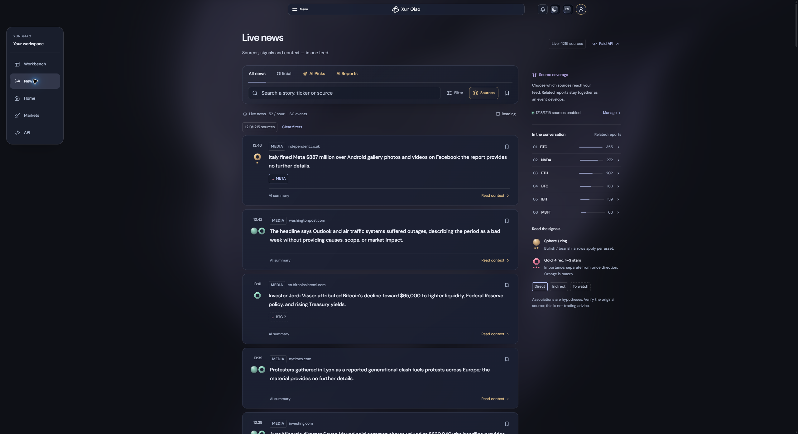</a>

### Control your source mix

The source selector lets you review and search the available source directory, then apply your selection. Source labels and status help explain the coverage in your feed. The selection is a reading preference; it does not turn a third-party report into a verified fact.

<a href="assets/news-sources.png">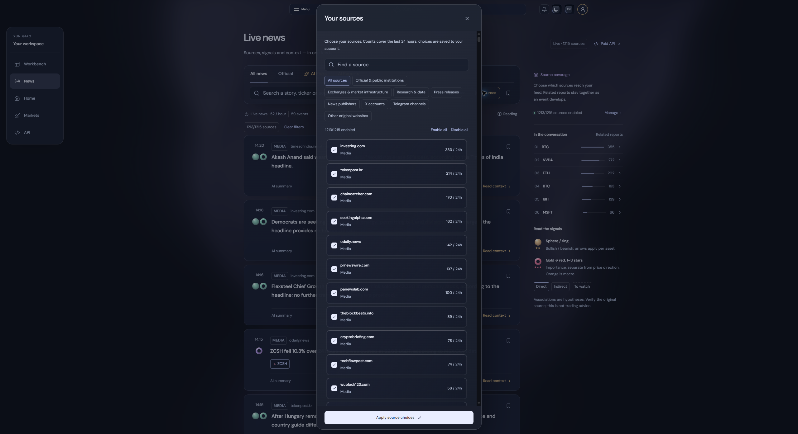</a>

## AI Picks and event collections

### Prioritize important developments

AI Picks can be sorted by **24-hour importance** or **latest first**. Use the ongoing macro view for developments whose influence extends beyond one short headline cycle.

### Follow the event, not just its repeated headlines

Related reports can be consolidated into an **event set**. Its card provides a synthesized title, the number of reports and a path into the underlying developments. New reporting can join an existing set, while periodic consolidation reviews the broader observation window.

This preserves the distinction between “many articles” and “many independent catalysts.” Several outlets repeating one announcement do not automatically create several independent reasons to expect a price move.

<a href="assets/news.png">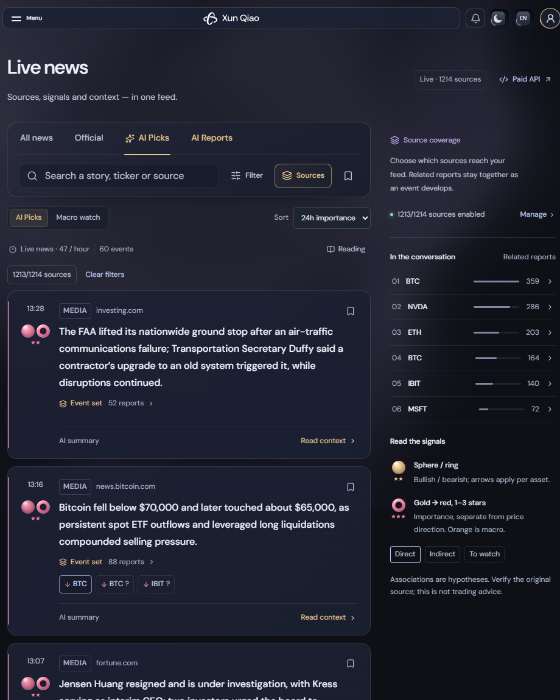</a>

### Open the context behind a card

Expand a story to read its available body, background and analysis. Structured sections can explain why it matters, what would support an interpretation, what would change the view, and which risks or uncertainties deserve attention. Event sets also provide a way to inspect the reporting that contributes to the summary.

<a href="assets/event-detail.png">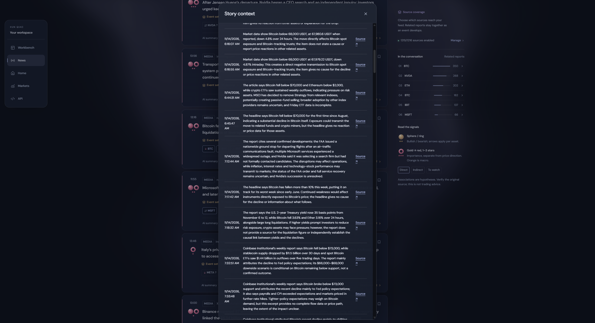</a>

## Asset links and visual signals

### Tags describe relationships, not just matching words

The tag system connects individual tradable instruments with smaller groups, broader sectors and macro partitions. Clicking a tag explains its meaning. Different borders distinguish **direct, indirect and watch** relationships.

An association can be useful even when the asset is not literally named in the headline. It remains a research hypothesis: sector exposure, a macro transmission channel and a direct company announcement are different strengths of connection.

### Spheres, rings, colors and stars

| Signal | How to read it |
| --- | --- |
| **Sphere / ring** | A bullish / bearish interpretation for the associated asset. Different assets may have different directions for the same event. |
| **Gold, one to three stars** | One range of event importance. |
| **Red, one to three stars** | A higher importance range; red is not itself a price-down label. |
| **Orange** | Ongoing macro context. |
| **Green / purple** | Other grades within the event system; these events still contribute to association research. |
| **Three tag-border styles** | Direct, indirect and watch relationships. |
| **Möbius ring on an AI report** | A separate five-hour research-opportunity rating, not a single-event importance mark. |

**Importance, direction and confidence are separate questions.** A high-star event is not an instruction to buy or sell. Read the linked evidence and the conditions behind the interpretation.

## Structured AI reports

### A research view for the next five hours

The leading assets by related-information count are scheduled for ongoing reports. The top-ten schedule targets **one analysis per asset every 30 minutes**, staggered by **three minutes** between assets. A changing ranking and data availability affect what is ready to read.

Choose all reports or an individual asset. Cards show the instrument, report time, Möbius-ring grade, summary and available long / short estimates. Open the report to see how the conclusion was reached.

<a href="assets/reports-feed.png">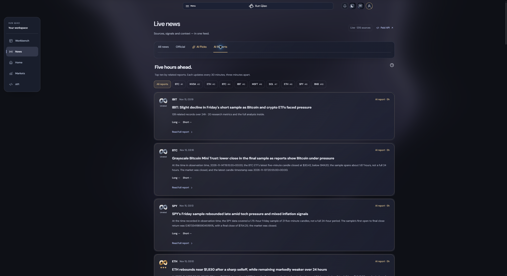</a>

### The details behind the summary

Report details can include the following fields when the inputs support them:

| Area | Examples of information shown |
| --- | --- |
| **Research stance** | Five-hour decision state, directional view, long / short estimates. |
| **Conditions** | Observation or entry zone, confirmation trigger and invalidation price. |
| **Risk structure** | Target, reward-to-risk estimate and explicit failure conditions. |
| **Illustrative sizing** | Example-account risk budget, allocation and conditional position quantity. |
| **Observed market** | Window range, observed return, turnover, candle count and window end time. |
| **Technical context** | RSI14, ATR14 and a 20-period mean when available. |
| **Evidence quality** | Evidence count, confidence score, conflicting information and data limitations. |
| **Opportunity score** | Timing, location, risk structure, indicative capital capacity and catalyst / evidence components. |

The text explains the market structure, important reporting, supporting observations and counterevidence. Additional sections cover **when to consider the scenario, what invalidates it, the next checks, probability rationale and risks**.

<a href="assets/reports.png">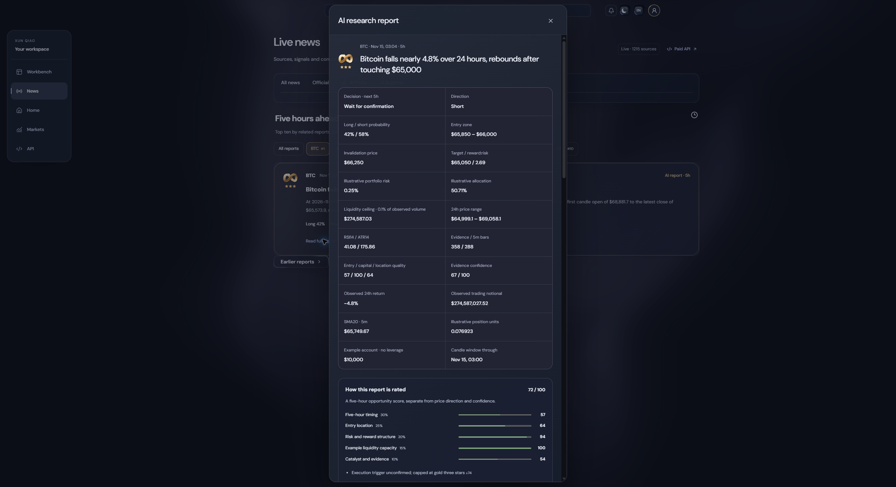</a>

### Ratings with an explanation

The rating breakdown separates the composite opportunity score from directional confidence. It shows weighted components and any score ceiling, such as an unconfirmed trigger or insufficient market context. The six star levels span gold one to three and red one to three.

| Grade | Score band | Meaning in the current report framework |
| --- | --- | --- |
| Gold, one star | 0–39 | Weak opportunity. |
| Gold, two stars | 40–59 | A developing setup. |
| Gold, three stars | 60–74 | Promising structure, with confirmation still needed. |
| Red, one star | 75–84 | An executable-opportunity classification, subject to its stated conditions. |
| Red, two stars | 85–91 | A stronger opportunity classification. |
| Red, three stars | 92–100 | Exceptional confluence within the framework. |

The current component weights are **timing 30%, entry location 25%, risk / reward structure 20%, example liquidity capacity 15%, and catalysts / evidence 10%**. Score ceilings can prevent a strong-looking aggregate from receiving an execution-level grade before its trigger is confirmed. These are research classifications, not performance guarantees.

Illustrative sizing uses a stated example account; it is not your balance. Observed-volume participation is a planning reference, not a measurement of executable liquidity. AI probabilities are subjective estimates rather than calibrated historical win rates.

<a href="assets/report-review.png">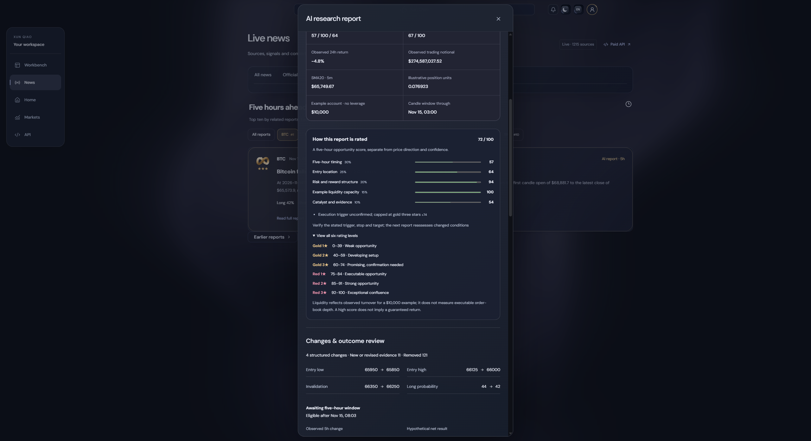</a>

## Plans, comparisons and reviews

### Research plans: make the next check explicit

A plan records what you are watching and which conditions would support or invalidate it. Start from your own hypothesis or bring conditions across from a report. For example, you might wait for a price to revisit an observed zone and require an additional piece of evidence before reconsidering the view.

Plans help preserve your reasoning. They do **not** submit orders, connect to a brokerage balance or promise an execution price.

### Report comparisons: understand what changed

Compare report versions to see changed conditions, targets, invalidation levels or probability estimates, alongside evidence additions and revisions. The useful question is why the view changed, not just whether the stars increased.

### Five-hour reviews: return to the original conditions

After the five-hour window ends and the necessary price data is available, reviews examine the subsequent path against the report's stated scenario. An unfinished window remains pending. Missing prices and uncertain within-candle sequences must remain uncertain.

A hypothetical OHLC-based review is different from an actual fill. It should not be read as a verified trading return or a promise that a historical condition could have been executed at the displayed price.

## Markets, charts and evidence

### A market overview with more than a price column

The markets page supports **All, Crypto, U.S. stocks and Stock tokens**. Search by ticker or name, switch to a watchlist view, and sort by related-event count, change, price or ticker.

Rows combine the instrument identity, price, change basis, recent trend and related-event context. Open an instrument to continue into its own chart and research. Stock tokens remain separate instruments from their underlying shares.

<a href="assets/markets.png">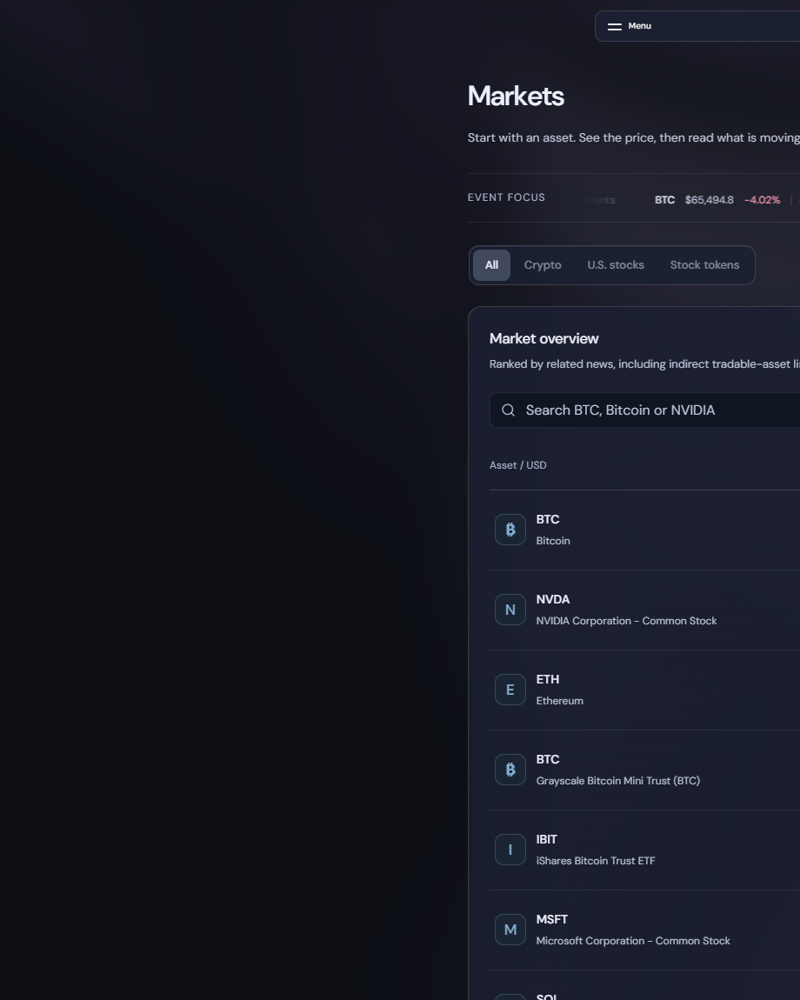</a>

### Chart and events

The chart view adds the selected instrument's price context, interval controls, OHLC values and optional event markers. Open a marker to inspect reporting, or continue to the asset's workbench. Events are positioned by reporting time, not by an asserted causal explanation for every candle.

<a href="assets/markets-chart.png">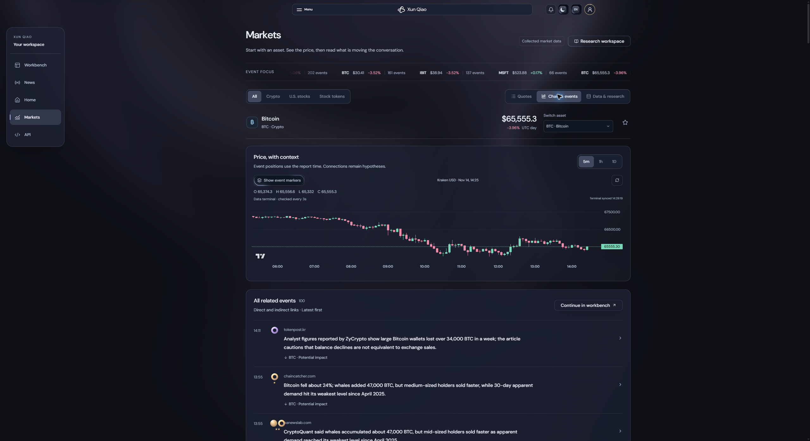</a>

### Data and research

The research view brings source observations, the asset snapshot and source-grouped research leads together. Inspect available price ranges, volume, capitalization and related evidence, then follow a source group back into the associated reporting.

Units and market sessions matter. An equity share count is not a dollar turnover figure, and a closed U.S. session is not equivalent to a continuously traded crypto venue. Use the displayed timestamps and definitions when comparing instruments.

<a href="assets/markets-research.png">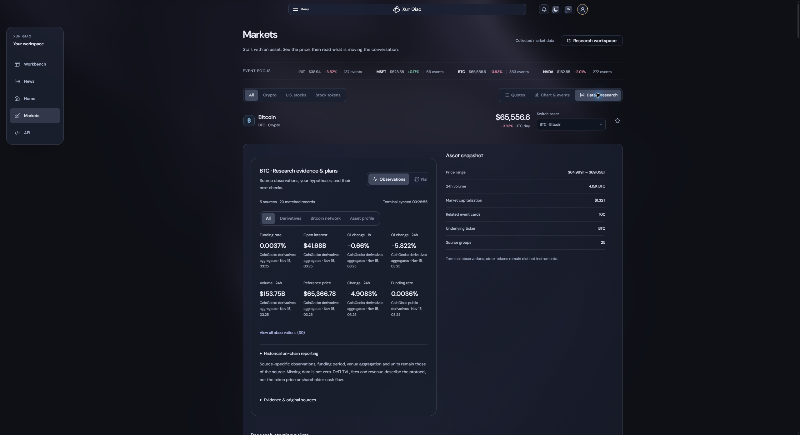</a>

## GPT conversations

### Continue the research with context

Gold members can discuss selected assets, reporting and available site context with GPT. Bring in the event or instrument you are examining and ask a concrete follow-up question, such as which facts are confirmed, which interpretation is indirect, or what evidence would challenge the report.

The site provides the AI service. You do not need to expose or configure a personal provider API key. Model-provider credentials stay out of the browser. Conversations remain research assistance; verify important claims against the linked material.

“Unlimited conversation” describes the absence of a fixed message-count allowance, subject to ordinary availability and anti-abuse controls. It does not make response accuracy or uninterrupted service a guarantee.

You can attach up to **eight assets and sixteen stories** in the context selector, search for another instrument and enable retrieval of relevant authorized site intelligence. The conversation interface supports new threads, history, copyable responses, stopping a response, retrying an incomplete request and opening cited research context. Private conversations are deliberately excluded from the public screenshots.

## Developer API

### Your site data, one read-only interface

The API page provides a catalog of **26 data recipes**, an interactive example area, an integration guide and key management. Free members can view the page; Gold membership is required for key creation and calls.

Data groups cover news, official updates, AI Picks, macro observations, story details, instruments, quote snapshots, complete asset workspaces, related events, research observations, reports, reviews, calendars, source labels, association rankings and taxonomy. Optional private-workspace scopes expose **only your own** notes, preferences, plans and inbox data.

**Real-time candlestick series are excluded from the external API.** Source distribution permissions and account access still apply; a visible source label is not a grant to redistribute every underlying item.

<a href="assets/api.png">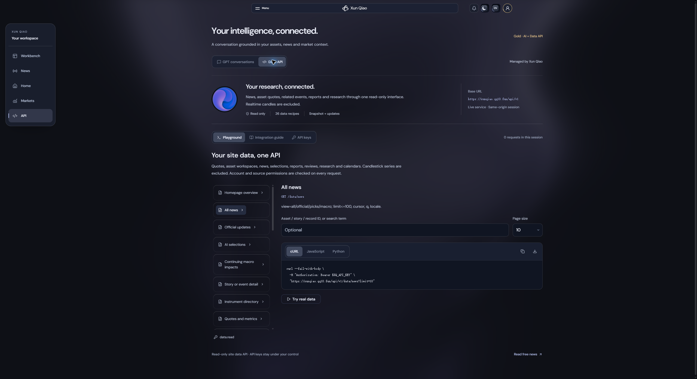</a>

### Learn, try and integrate

Choose a recipe, enter an instrument, story or record identifier when needed, select a page size and switch between **cURL, JavaScript and Python**. Copy or download a request example. The permitted live-data action provides a response preview and a full-response download.

Key management supports names, read-only scopes and revocation. A newly created secret is shown once. Store it on your server, pass it in the Authorization header, and never commit it or place it in a public frontend bundle.

Use stable IDs from the instrument directory and the endpoint's pagination contract. Incremental feeds use cursors so your integration can process additions, corrections and withdrawals rather than repeatedly downloading everything.

<a href="assets/api-guide.png">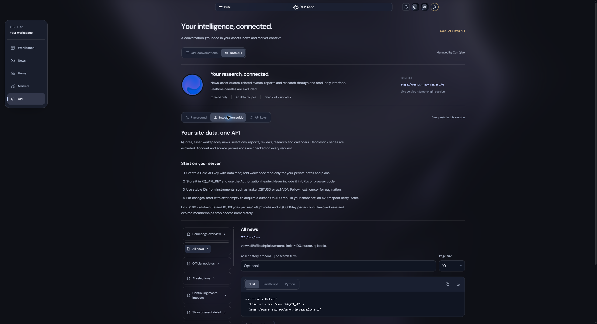</a>

**[Read the detailed API guide and all 26 routes →](API-GUIDE.md)**

## Accounts and membership

### Free core research, with optional premium services

| Capability | Guest · Bronze | Free account · Silver | Premium · Gold |
| --- | :---: | :---: | :---: |
| Complete public homepage | ✓ | ✓ | ✓ |
| Full news reader and Official updates | Sign in | ✓ | ✓ |
| AI Picks and published AI Reports | Sign in | ✓ | ✓ |
| Workbench, markets and event research | Sign in | ✓ | ✓ |
| Personal research features | Sign in | ✓ | ✓ |
| View the developer page and documentation | Sign in | ✓ | ✓ |
| GPT conversation replies | — | Upgrade | ✓ |
| Create API keys and call the developer API | — | Upgrade | ✓ |

Registration and email verification create a free ordinary membership. The personal center separates the membership card from settings. It provides the relevant access status and paths to account support, preferences and premium activation.

Membership identifiers are unique numeric card numbers, not financial accounts. Gold offers a one-time choice of an eligible leading or trailing number pattern; the remaining digits are assigned by the service. Confirm a pattern carefully because a completed choice cannot be changed.

Premium activation and validity, including any monthly or lifetime options, follow the current site instructions. Redeem a code only on the account you intend to upgrade. Do not publish your code or membership number in an Issue.

## Personalization and notifications

### Dark by default; light with the same research tools

Switch theme and language from the header. English and Simplified Chinese are available, and the light theme retains a background and frosted surfaces rather than replacing every surface with plain white.

Dark and light backgrounds have **separate preferences**. Available shapes include Plasma, Aurora, Silk and Gradient Bars, with named color palettes, a custom color option, intensity and supported animation controls. Choose a moving or static background, or a reduced-motion experience.

Reading settings include density, time-zone preferences and event-display controls. Source and layout settings help keep your research view useful without making every user follow the same screen arrangement. Desktop navigation is on the left; mobile navigation uses the five main sections.

<a href="assets/appearance.png">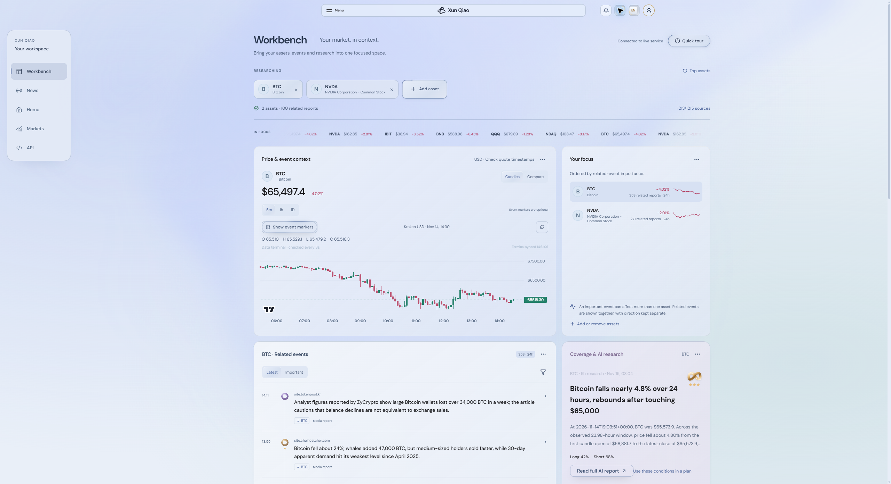</a>

### Announcements and opt-in research alerts

Announcements become available after login. Market-event and research-change alerts are **opt-in**. Choose your focus, importance conditions and available batching preferences rather than receiving every event by default.

The inbox distinguishes administrative announcements from research information. Alerts are prompts to review evidence, not execution instructions.

### Loading and returning to your workspace

The site uses a prepared data terminal and local interface caching. The homepage is prepared first, while other views can continue loading in the background. Progress and connection states explain what is happening; the last usable snapshot can remain visible while newer data is requested.

A first visit can take longer while interface resources download, especially on a slow connection. Coverage and refresh times vary by source and market. The displayed terminal times describe the view you are reading; they do not make every upstream feed a tick-for-tick exchange feed.

## Get started in a few minutes

1. **[Open Xun Qiao](https://xunqiao.qq10.fun/)** and explore the public homepage.
2. **Create a free account** to enter the research pages.
3. **Select your assets** and open one as the active focus.
4. **Read the evidence** alongside the chart, then inspect a report's conditions and counterarguments.
5. **Keep your own reasoning** in notes or a plan. Enable alerts only if you want them.

**[Continue with the practical user guide →](GUIDE.md)**

## Frequently asked questions

### Do I need Gold to read AI Picks or published reports?

No. A free ordinary account can read those research views. Gold adds GPT conversation replies and developer API access.

### Is this a broker, trading bot or order-entry terminal?

No. It is an information and research website. It does not execute trades or manage brokerage balances.

### Are the report probabilities verified win rates?

No. They are subjective research estimates. Report grades, confidence and direction have different meanings. Read the underlying conditions and limitations.

### Why do a card count and an association count differ?

An event set can contain several distinct reports, and the relationship ledger includes lower-rated and indirect associations. A displayed-card count is not necessarily the number of related underlying records.

### Does every instrument have every metric?

No. Coverage, update frequency, trading sessions and distribution permissions vary. Missing values should stay missing. Two sources can also use different definitions for similar-looking metrics.

### Can I export another member's private workspace?

No. Private-workspace API access is scoped to the authenticated account and requires the relevant permissions.

### Can I download the complete website source here?

This repository publishes the **product introduction, guides, screenshots and feedback channel**. It is not a complete source release or self-hosting package. Public documentation does not grant redistribution rights to third-party components or data.

## Feedback and project information

**[Open an Issue](https://github.com/xunqiao111/xunqiao-market-intelligence/issues)** with the page, device, browser, reproduction steps, expected behavior and a screenshot without personal information. Feature suggestions are welcome. Star the repository if you want to bookmark the project.

Never post passwords, email verification codes, activation codes, API secrets, membership numbers or private conversations. The maintenance console and operational account information are restricted to maintainers and are not part of this public gallery.

The interface uses components and assets including **[React Bits](https://github.com/DavidHDev/react-bits)**. Third-party components, fonts, content and data remain subject to their respective rights. Pro component source is not redistributed in this repository.

Screenshots were captured from the live English interface on **2026-11-15**. News, prices and AI output can be inaccurate or incomplete. Verify original sources independently. The screenshots and research tools are not investment advice, factual endorsements of every headline, or promises of profit.

---

### Spend less time switching tabs. Keep more of the evidence.

**[Explore Xun Qiao](https://xunqiao.qq10.fun/)**

