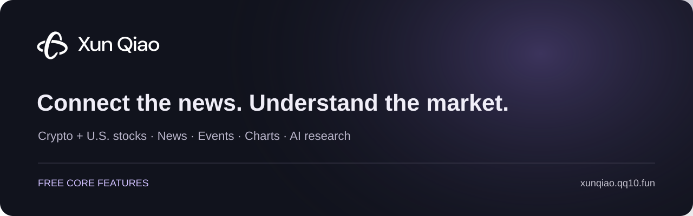

<div align="center">



# 讯桥 · Xun Qiao

**从快讯，看懂市场。**

面向加密货币与美股的市场情报网站，把快讯、关联事件、价格走势与 AI 研究放进同一个研究空间。

**[立即访问网站 ↗](https://xunqiao.qq10.fun/) · [使用指南](GUIDE.md) · [API 文档](https://xunqiao.qq10.fun/api-docs) · [反馈与建议](https://github.com/xunqiao111/xunqiao-market-intelligence/issues)**

简体中文 · [English](README.en.md)

**1000+ 来源覆盖 · 核心功能免费 · 加密 + 美股 · 中英文 · 深浅主题**

</div>

---

你可能同时开着新闻网站、行情软件、日历和笔记。讯桥希望把这些线索连接起来：**发生了什么，影响哪些资产，价格如何变化，接下来应该验证什么。**

无需下载客户端。游客可以直接查看完整主页；免费注册后，即可使用快讯、工作台、行情与已发布的 AI 研究。高级会员提供额外的 AI 对话和开发者 API 权益。


## 从一条消息，到一个研究判断

**发现消息 → 查看关联资产 → 对照行情与证据 → 阅读 AI 报告 → 记录条件 → 跟踪变化与复盘**

| 你想解决的问题 | 在讯桥怎么做 |
| --- | --- |
| 消息太散，来回切换网站 | 在快讯页集中阅读媒体、官方公告和公司动态，按来源、关键词及条件筛选 |
| 同一事件被反复报道 | 在 AI 精选里查看事件集，将相关进展和多篇报道放在一张卡片里 |
| 知道新闻，却不知道影响谁 | 查看关联标签、关联强度和资产维度的利多 / 利空判断 |
| 只有价格，看不到市场背景 | 在工作台对照 K 线、关联事件、关键数据与研究资料 |
| AI 只给一句结论 | 阅读结构化报告中的证据、条件、风险与判断失效位置 |
| 想持续跟踪自己的想法 | 使用收藏、研究笔记、研究预案、报告变化对比和五小时复盘 |

## 核心功能

### 01 · 实时快讯，保持自己的阅读节奏

- 汇集 **1000+ 来源**，覆盖加密货币、美股、公司公告及宏观市场信息；具体来源数量随站内目录更新。
- 四个阅读入口：**全部快讯、官网动态、AI 精选、AI 报告**。
- 搜索消息、资产代码或来源；自选来源、筛选、收藏，并打开原始出处继续核对。
- 新消息自动进入信息流，阅读较早内容时保持当前阅读位置，减少跳动与打断。
- 快讯不仅有标题，还可以展开关联解读，查看已生成的背景分析与结构化信息。

### 02 · AI 精选与事件集，让后续进展连起来

- 对快讯进行重要度分析，支持**近 24 小时重要度排序**和**按时间排序**。
- 同一事件的多来源报道、补充信息和后续进展可以整合为**事件集**，保留汇总标题与报道数量。
- 新消息可以加入已有事件集，周期整合继续校正关联关系；事件集按最新进展的位置呈现。
- 提供宏观持续观察入口，方便把短期快讯放进更长的影响背景。
- 标签不只是关键词：从具体资产到小分区、大分区、宏观分区形成研究路径，并提供中英文含义说明。


### 03 · 研究工作台，围绕你的标的组织信息

选择一个或多个虚拟币、股票等标的，再聚焦当前正在研究的资产。默认从 BTC 和英伟达开始。

- **行情与事件背景**：5 分钟、1 小时、日线等图表周期；事件标记按需打开。
- **关联事件**：查看当前资产的相关报道、重要度、时间与来源，继续进入事件详情。
- **关键数据**：价格区间、成交量、市值及关联信息数量，按实际数据可用性显示。
- **研究资料**：把已有的衍生品、资金费率、持仓量、链上、供给和协议观测放回资产上下文。
- **接下来关注什么**：宏观、供给、活动与公司日程，帮助安排后续验证。
- **个人研究空间**：收藏、笔记、研究预案与报告入口，减少重复整理。

不同市场、场所与资产的数据覆盖有所不同；缺失字段不等于零。


### 04 · 行情页面，把走势和事件一起看

通过行情列表发现资产，在“图表与事件”中切换标的、周期和事件标记，再到“数据与研究”继续查看资料。加密货币与美股放在同一套研究流程中，也保留各自的交易时段和计量单位。

价格、区间、成交量、市值和走势图使用站内数据终端提供的数据。**请以页面所示时点、币种、单位和市场状态为准。**


### 05 · AI 报告，关注证据、条件和下一步

对近 24 小时关联信息数排名前列的标的进行持续研究：前十名按计划每 30 分钟分析一次，相邻标的错开 3 分钟调度。

报告综合近期消息、价格走势，以及可用的衍生品和链上等资料，围绕**未来五小时**呈现研究判断。内容包括行情背景、关键驱动、方向倾向、入场观察条件、失效条件、仓位与资金风险说明等；数据不足时保留不确定性。

你还可以：

- 将条件放入**研究预案**：记录“满足什么条件才继续关注”，方便持续验证。
- 查看**报告变化对比**：了解新证据使哪些判断发生变化。
- 查看**五小时复盘**：在观察窗口结束且价格资料足够时，检视当时的条件与后续行情。

AI 报告使用莫比乌斯环标识，与单条事件标记区分。评级、倾向和概率都是研究辅助，**不是经过保证的胜率，也不是交易指令**。预案与复盘不执行下单。


### 06 · 提醒、双语与个性化

- 登录后接收站内公告；市场事件及研究变化提醒由你自行开启，并按条件管理。
- 深色主题为默认；浅色主题同样提供背景与玻璃质感。
- 深浅主题分别设置背景形态、颜色及动态 / 静态偏好。
- 中英文切换，桌面左侧导航，手机底部导航；围绕不同屏幕安排内容。

### 07 · AI 对话与开发者 API（高级权益）

**AI 对话**可以带入当前资产、行情和站内情报，围绕你的问题继续研究。对话通过讯桥服务提供，无需自行配置模型密钥。

**开发者 API**提供经过权限控制的只读数据访问，包括快讯、AI 精选、事件集、AI 报告、资产概览、关联事件、行情快照和研究资料等。**实时 K 线不在对外 API 范围内。**

站内提供调用说明及 cURL、JavaScript、Python 示例。访问密钥由账户管理，请勿写进公开代码或截图。

```bash
# 先在站内获取自己的高级会员 API 密钥，并放入环境变量 XQ_API_KEY
curl -H "Authorization: Bearer $XQ_API_KEY" \
  "https://xunqiao.qq10.fun/api/v1/news?limit=30&view=compact"
```

**[查看完整 API 文档 →](https://xunqiao.qq10.fun/api-docs)**

## 免费使用与会员权益

| 功能 | 游客 · 铜卡 | 普通会员 · 银卡 | 高级会员 · 金卡 |
| --- | :---: | :---: | :---: |
| 完整主页、市场焦点、主页快讯与日程 | ✓ | ✓ | ✓ |
| 全部快讯、官网动态与 AI 精选 | 登录后 | ✓ | ✓ |
| 工作台、行情及已发布的 AI 报告 | 登录后 | ✓ | ✓ |
| 收藏、笔记与个人研究功能 | 登录后 | ✓ | ✓ |
| 进入 API 页面查看功能说明 | 登录后 | ✓ | ✓ |
| AI 对话回复 | — | 需升级 | ✓ |
| 生成开发者 API 密钥与调用 | — | 需升级 | ✓ |

**注册登录即为免费普通会员。** 高级权益为可选服务，实际开通方式和有效期以站内说明为准。

## 如何理解球、环、星与标签

| 标记 | 读法 |
| --- | --- |
| 球 / 环 | 对应某个关联资产的利多 / 利空判断；同一事件对不同资产可能方向不同 |
| 金色 1–3 星、红色 1–3 星 | 事件重要程度；颜色和星级不能直接当作涨跌方向 |
| 橙色标记 | 宏观持续影响相关的观察 |
| 绿色 / 紫色标记 | 同样属于信息与关联体系，不意味着可以忽略 |
| 三种标签边框 | 区分直接、间接、观察等关联强度；点击标签可查看含义 |
| 报告莫比乌斯环 | 面向五小时研究窗口的综合评级，与事件重要度评级含义不同 |

关联是一条需要核对的研究线索。既不要把“标签相关”当作因果确定，也不要把“高星”直接理解为必须交易。

## 开始使用

1. 打开 **[xunqiao.qq10.fun](https://xunqiao.qq10.fun/)**，先看主页的市场焦点与快讯。
2. 免费注册并登录，进入工作台，添加你关注的币或股票。
3. 从当前资产的关联事件开始，对照行情和原始出处，再阅读 AI 报告。
4. 记录自己的判断条件；需要提醒时，再主动开启相应提醒。

首次访问需要下载界面资源，较慢网络可能需要约一分钟。之后会利用本地缓存和数据终端快照加快打开；具体体验取决于网络与数据可用性。

## 常见问题

**必须付费才能看 AI 精选或报告吗？**  
不需要。免费普通会员可以阅读已发布的精选、解读与报告；高级权益主要包括 AI 对话和开发者 API。

**可以自动交易吗？**  
不可以。讯桥提供信息与研究工具，不代客下单，也不连接账户执行交易。

**所有资产的数据都完整、同一时刻更新吗？**  
不是。不同来源和市场覆盖不同，休市、数据缺失和采集状态都会影响可用内容。请核对页面时间、单位与出处。

**这个仓库可以下载网站源码并自行部署吗？**  
本仓库用于产品介绍、真实截图、使用说明和问题反馈。目前不提供网站完整源码或自部署包；公开介绍不代表授予第三方组件或数据的再分发权。

## 反馈与交流

欢迎 **Star** 收藏项目，也欢迎通过 **[Issues](https://github.com/xunqiao111/xunqiao-market-intelligence/issues)** 提交使用体验、功能建议和可复现问题。

反馈时请说明设备、浏览器、页面、操作步骤及期望结果，并附上已去除个人信息的截图。**不要公开密码、验证码、API 密钥、卡号或私人对话。**

本项目界面使用了 [React Bits](https://github.com/DavidHDev/react-bits) 等组件素材；相关组件、字体和第三方内容权利归各自权利人。本仓库不再分发 Pro 组件源码。

---

截图采集于 2026-11-15，为网站真实界面；页面中的价格、新闻与分析仅代表截图时点，不构成当前事实背书或投资建议。市场信息及 AI 输出可能有误，请独立核实并自行承担决策风险。

<div align="center">

**少一些来回切换，多一些有据可查的思考。**

**[打开讯桥 ↗](https://xunqiao.qq10.fun/)**

</div>
